# Agent development plan — Majestic P.L.T.

> **Status:** draft for review · written 2026-10-07 · nothing in this document is built yet.
> **Audience:** the owner of the app and whoever implements the agent.
> **Basis:** `CLAUDE.md`, `diary.md`, the graphify files (`graphify-out/GRAPH_REPORT.md`, `wiki/index.md`, queries) and a read of the code named in each section.
> **Mockups:** the pictures marked *Mockup* are illustrative (invented numbers, static HTML in `docs/agent_development/mockups/`). The pictures marked *Today* are screenshots of the running app.

---

## 1. In one page

**What we want:** an agent inside the app that can (a) **run simulations** (what-ifs over routes, shipments, market levels, taxes, payroll, accounting), (b) **update values** (settings, route parameters, priority lists, saved tax multipliers…) safely, and (c) **explain** what it did and why — across the modules the app already has.

**How, in six decisions:**

1. **The model plans; the app computes.** Every number the agent reports comes from a deterministic engine in the app (the same ones the screens use), called as a *tool*. The model chooses tools, compares results and writes the explanation. This is the same lesson the diary records for the Tax Calculator: models misread tables, code does not.
2. **Three kinds of tools, three trust levels.** *Read* (look), *Simulate* (compute on a copy, nothing saved), *Write* (change data). Writes are **proposed as change sets** — before/after, reason, risk — and applied only after approval (or automatically for low-risk, reversible tiers if the owner opts in). Every write is logged and **undoable**.
3. **Build on what exists.** The sidebar Assistant already runs a Claude tool-use loop (`backend/routers/assistant.py`, 7 tools, background builds, chat history). The agent generalises that loop into a tool registry, a guard and an audit trail instead of starting over.
4. **Port the logic that lives only in the browser.** Much of the money logic is pure JavaScript (`routeMetrics.js`, `shipmentBuilder.js`, `shipmentFinance.js`, `marketOpportunitySettings.js`…). A server-side agent needs Python versions, **parity-tested against the JavaScript** with shared fixtures, so the screen and the agent can never disagree.
5. **Simulations are branches.** A defined baseline is `main`. Every simulation opens a **branch** — a copy of the database — and the agent plays with the values *in the branch*; the app's own modules are measured on it, the branch is compared with `main`, and a good branch is **merged into live data as a change set** (never by copying the file over). Exactly like Git, minus the code (§6).
6. **Three model lanes.** A **local model** (Ollama) does simple, bounded tasks whose data is inside the app's DB and whose output code can validate (e.g. a written shipment instruction → typed parameters). **Claude (API)** plans, searches the web, orchestrates updates and handles anything open-ended or untrusted. A third lane has the **local model draft and Claude check** — cheap, and safe where it matters (§8).

**Delivery:** six phases, about **9 weeks for one human developer** (about 5–7 working days of my own coding time, §12), each phase shippable on its own. The first useful release (read + explain + branches with route/market simulations and a comparison table) is at the end of phase 2.

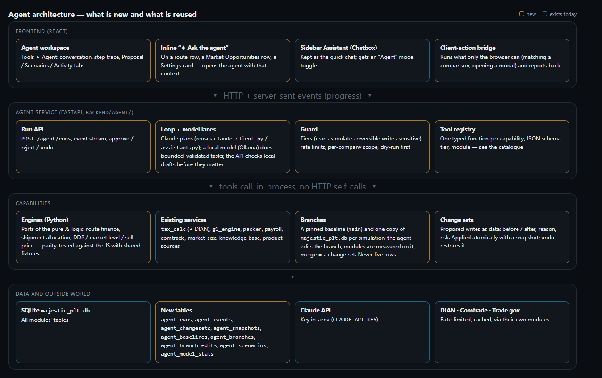
*Mockup — what is new (amber) and what is reused (blue). Branches and the model lanes are part of the design from the start.*

---

## 2. Goals and non-goals

**Goals**
- Answer "what if…" questions about the business in seconds, with a scenario table the owner can trust and reproduce.
- Make routine updates conversational ("raise the niche profit to 25 %", "refresh the Jamaica sources and tell me what changed") with a preview and an undo.
- Explain existing numbers ("why is this product's Tax × '—'?", "why did the shipment drop products?") using the app's own data.
- Leave a complete audit trail: who asked, what ran, what changed, how to revert.

**Non-goals (first version)**
- No autonomous money movement: bank transfers, accounting entries and deletions stay human-only (a *sensitive* tier that is off by default).
- No replacement of the screens. The agent works *through* the same data and rules; every change it makes is visible in the normal UI.
- No **local-only** agent. The diary records that local models (gemma3, qwen3) misread tariff tables even with tools (0–1 of 4 on the tomato question), so the *planner* and anything open-ended stay on Claude. Local models still have a defined, validated job (§8): simple tasks on data that lives in the app's own DB.
- No new financial metrics inside this project (NOPLAT, EBITDA, valuation are stubs today — see §3). The plan notes where a metrics layer would plug in.

---

## 3. What the app has today (the evidence this plan rests on)

### 3.1 Modules and where they live

| Module | Backend | Frontend | What an agent could do with it |
| --- | --- | --- | --- |
| **Revenue routes & Shipment builder** | `routers/revenue_streams.py` (routes, route settings, outbound/return shipments) | `FinancialTab/RevenueStreamsView.jsx`, `ShipmentBuilder/*`, `routeMetrics.js` | Simulate caps, cargo %, return type, air fare; update route fields; rebuild shipments |
| **Market Opportunities** | `routers/market_opportunities.py`, `routers/market_opportunity_settings.py` | `marketAnalysis/MarketOpportunitiesPanel.jsx`, `services/marketOpportunities.js`, `marketOpportunitySettings.js` | Read comparisons, explain gaps, edit the margin scale and Destination Market rules, manage the priority list |
| **Tax Calculator** (Jamaica, USA, Colombia/DIAN) | `tax_calc/`, `tax_calc/colombia_dian/`, `routers/tax_calculator.py`, table `product_tax_multipliers` | `taxCalculator/*` | Compute per-kg taxes for any product/pair; save multipliers; what-if on tariffs |
| **Settings** | `routers/settings.py` (calendar mode, projection years, phases, benefits, inflation, payroll schedule), expense categories | `ManagementTab/SettingsView/*` | Read and update portfolio settings with preview/undo |
| **Commercial operations + ledger** | `routers/commercial_operations.py`, `gl_engine.py`, `routers/general_ledger.py`, `accounting_auditor.py` | `OperationsTab/CommercialOperationsView`, `FinancialTab/Accounting/*` | Read entries and balances; simulate parameter changes through the ledger engine; run the accounting health check |
| **Simulations (parameters)** | `routers/sim_parameters.py` — *"values a future simulation agent should be able to manipulate; no simulation logic reads it yet"* | `simulations/SimulationsView.jsx`, `SimParametersView.jsx` | The user already flags which commercial entries are simulation parameters: the agent's natural **input list** |
| **Payroll / org** | `routers/payroll.py`, `payroll_levels.py`, `payroll_schedule_settings.py` | `ManagementTab/PayrollView/*` (country payroll-tax maths is in `services/*PayrollTax.js`) | Headcount/raise what-ifs; payroll tax by country |
| **Startup investment, bank accounts** | `routers/startup_investment.py`, `bank_accounts.py` | `FinancialTab/StartupInvestmentView.jsx`, `BankAccountsView.jsx` | Read; scenario on funding/spend (writes = sensitive) |
| **Air logistics, cargo load (packer)** | `routers/air_logistics.py`, `packer/*` (Python engine, 3-D load plan, work orders) | `FinancialTab/AirLogistics/*`, `packer` page | Compare aircraft/providers; load-plan optimisation (engine already Python) |
| **Knowledge base, RAG, reports, local models** | `routers/knowledge_base.py`, `rag_files.py`, `local_models.py`, `assistant.py` | `chatbox/*`, `ragFiles/*` | Search documents, build profiles/analyses, refresh sources and SAM/TAM (**already tools today**) |
| **Market data** | `routers/comtrade.py`, `country_profile.py`, `product_sources.py`, `supermarket_catalog.py` | Market Analysis, Global Trade Data | Refresh, read SAM/TAM, explain gaps |

`Simulator` and `Drivers` (company tabs) and `Financial Modeling` (NOPLAT, EBITDA, Cap Table, Valuation) are **placeholders today** — each renders only a title and a sentence. There is no financial-metrics layer yet, so "profit" in this plan means what the app computes now (route Revenue/COS/Profit, market DDP/sell price, ledger balances).

### 3.2 The existing Assistant (the starting point)

`backend/routers/assistant.py` is a server-side Claude tool-use loop (httpx to the Anthropic API, model in `knowledge_base/claude_client.py`, key `CLAUDE_API_KEY` in `.env`): max 6 tool rounds, 2,000 output tokens, 30 messages of history, messages persisted in `assistant_messages`. Its 7 tools — `search_knowledge_base`, `list_countries`, `build_country_profile`, `build_competitiveness_analysis`, `list_product_sources`, `refresh_product_source`, `refresh_market_size` — are exactly "read" and "reversible write" capabilities. Builds that need the browser are returned as *actions* the chat window executes (`useChatbox.js → runAssistantAction`). The agent keeps this shape and adds: a registry, tiers, scenarios, change sets, audit, streaming progress.

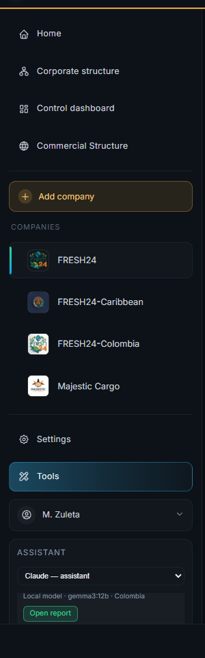
*Today — the Assistant lives at the bottom of the sidebar: a model selector, a short log, a composer.*

### 3.3 Where the calculations are (and why this matters for an agent)

- **Python (usable by the agent as is):** the tax calculators (`tax_calc/`, incl. DIAN), the ledger engine (`gl_engine.py`), the packer, SAM/TAM, accounting auditor, product-source analysis.
- **JavaScript only (must be ported or bridged):** route metrics and leg pricing (`routeMetrics.js`, plus `priceFor` inline in `RevenueStreamsView.jsx`), shipment allocation and groups (`shipmentBuilder.js`), cost chain and levels (`shipmentFinance.js`, `useLegFinance.js`), market level and suggested sell price (`marketOpportunitySettings.js`), the **matching of a Market Opportunities comparison** (`services/marketOpportunities.js` — products, units, FX, AI-assisted matching) and the payroll-tax maths.
- **Consequence:** a server-side agent cannot call these today. §6 explains the two-track answer (port the small pure engines; bridge the heavy browser-bound ones).

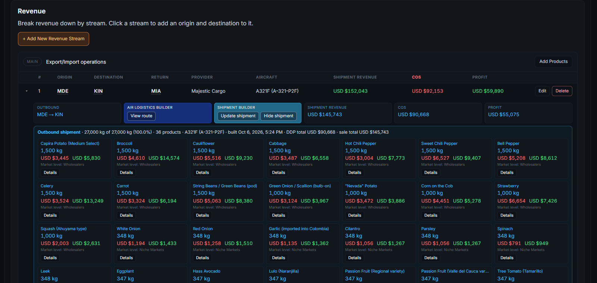
*Today — Revenue routes: per-leg Revenue / COS / Profit, the Air Logistics Builder, the Shipment builder and its product cards. Almost every number here is a candidate for "simulate this with X changed".*

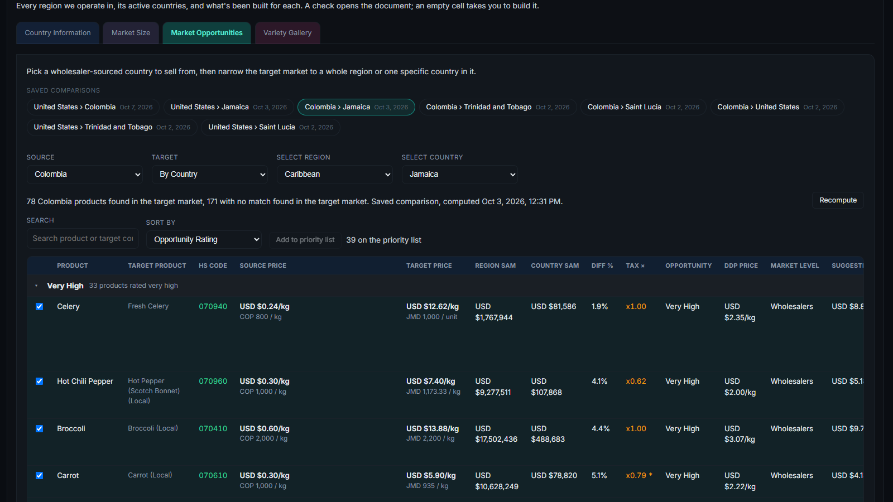
*Today — Market Opportunities (Colombia → Jamaica): Tax ×, Opportunity, DDP price, Market Level, Suggested sell price.*

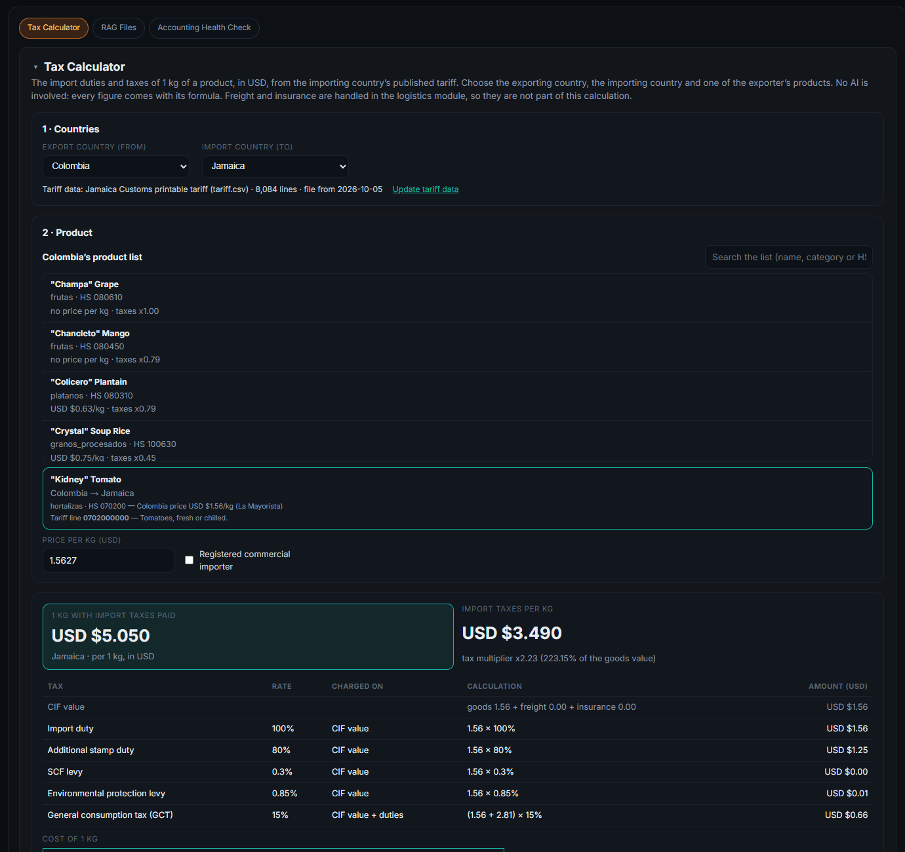
*Today — Tax Calculator: one flow for every country, 1 kg in USD, saved into the market analysis.*

### 3.4 Constraints to design around

- **One SQLite file** (`majestic_plt.db`, ~10 MB, tracked in git): a **branch is simply a file copy** (a fraction of a second, so dozens are cheap); live writes must be short transactions. Data that lives *outside* the DB (RAG files, `backend/documents/tax_data/`, report PDFs) is not copied: branches read those files read-only (§6.3).
- **Single user, no authentication** in the app today: "who approved" is the signed-in display name (M. Zuleta) — fine, but the audit log should not pretend to be a security boundary.
- **Windows dev environment:** uvicorn `--reload` is unreliable (diary: restart fully) and installs the Selector event-loop policy (Playwright needs Proactor — already handled in `browser.py`). Long agent runs must be **background jobs polled by the UI**, not in-request work.
- **External rate limits:** DIAN (≈5 requests per product, cached 24 h), Comtrade, Trade.gov. The guard must rate-limit tools that hit them.
- **Never overwrite saved settings while testing** (incident of 2026-10-06): the agent's tests run on a sandbox DB, never on `majestic_plt.db`.

---

## 4. Principles

1. **Numbers come from engines, never from the model.** The system prompt forbids arithmetic in prose; reported figures must cite a tool result id. A response with a number that no tool returned is a test failure (§13).
2. **Simulate first, write second.** Any write the agent wants is preceded by a simulation of its effect when one exists.
3. **Everything is reversible except what is explicitly sensitive.** Reversible writes store a snapshot of the rows they touch. Sensitive writes are off by default.
4. **Small, typed, composable tools.** One tool = one capability with a JSON schema, a tier, an owning module, and a unit test. No "run arbitrary SQL" or "call any URL" tool, ever.
5. **Show the work.** Every run shows its steps (tool, inputs, time, result summary). Nothing the agent did is hidden.
6. **Same rules as the screens.** The agent cannot do what the UI forbids (validation lives in the shared function, not the screen).
7. **Cheap by default.** Tool results are summarised before they return to the model; prompt caching on the static prefix; per-run token and tool-call budgets.

---

## 5. Tool catalogue

Tiers: **R** read · **S** simulate (compute on a copy; nothing saved) · **W** reversible write (change set, snapshot, undo) · **X** sensitive write (off by default; explicit confirmation every time).
Status: ✔ exists today as a callable Python function or assistant tool · ◐ exists in JavaScript only (port needed) · ○ new.

### 5.1 Context and navigation
| Tool | Tier | Status | Notes |
| --- | --- | --- | --- |
| `app_overview` | R | ○ | The module map and the current context (company, route, pair) — generated from this registry so the prompt never goes stale |
| `list_companies`, `list_countries` | R | ✔ | `list_countries` exists in the assistant |
| `search_knowledge_base` | R | ✔ | Existing |

### 5.2 Revenue routes and shipments
| Tool | Tier | Status | Notes |
| --- | --- | --- | --- |
| `get_route(route_id)` / `list_routes(company)` | R | ✔ | `revenue_streams.py`; includes legs, aircraft, provider, settings |
| `get_route_finance(route_id)` | R | ◐ | Per-leg + total Revenue/COS/Profit exactly as the table shows them (engine port) |
| `simulate_route(route_id, overrides)` | S | ◐ | Overrides: return type, target cargo %, leg cost %, GSA price, COS per kg, aircraft, provider block-hour cost, air-fare multiplier |
| `simulate_shipment(route_id, leg, overrides)` | S | ◐ | Rebuild the allocation with other caps/sell %/margin rules; returns kg, DDP, sale, level per product |
| `optimize_caps(route_id, objective)` | S | ○ | Search over caps (grid / simple hill-climb) using `simulate_shipment`; objective = profit, revenue or full payload |
| `update_route_settings(route_id, fields)` | W | ✔ | `PATCH …/settings` (validated) |
| `rebuild_shipment(route_id, leg)` | W | ◐ | Applies a simulated allocation (keeps manual weights fixed, like *Update shipment*) |
| `set_manual_weight(route_id, leg, product, kg)` | W | ✔ | The Details ▸ Edit behaviour |
| `create_route`, `delete_route` | X | ✔ | Route structure changes |

### 5.3 Market Opportunities and market settings
| Tool | Tier | Status | Notes |
| --- | --- | --- | --- |
| `get_comparison(source, target)` | R | ✔ | Saved rows, ratings, unmatched list |
| `explain_missing(product, pair)` | R | ○ | Why a Tax ×, source price or FCA is empty (the investigations done by hand in this project: units not convertible, no multiplier saved, no HS code…) |
| `simulate_margin_scale(tiers)` | S | ○ | How many saved rows would change rating, before saving |
| `simulate_destination_markets(rules)` | S | ◐ | Market Level / sell price / caps under other ranges |
| `update_margin_scale`, `update_destination_markets` | W | ✔ | `PUT /market-opportunity-settings` — **re-rates every saved comparison**, so it always shows the simulated impact first (the incident of 2026-10-06 is why this is a *propose* tool only) |
| `add_to_priority_list` / `remove_from_priority_list` | W | ✔ | Existing endpoints |
| `recompute_comparison(source, target)` | W | ◐ | Matching runs in the browser → **client action** (§6.4) |

### 5.4 Taxes
| Tool | Tier | Status | Notes |
| --- | --- | --- | --- |
| `calculate_taxes(origin, destination, product, price)` | R/S | ✔ | `tax_calc` (Jamaica, USA) and `colombia_dian` (live, rate-limited, cached) |
| `simulate_tariff_change(destination, line, delta)` | S | ○ | "What if Colombia's Gravamen on beef is 60 %?" — recomputes multipliers and downstream DDP |
| `save_tax_multiplier(origin, destination, product)` | W | ✔ | Existing `POST /tax-calc/multipliers/save` |
| `fill_multipliers(pair, products[])` | W | ✔ | Loops `calculate` + `save` under the DIAN rate limit (e.g. the priority list only — never the whole portfolio) |

### 5.5 Settings and calendar
| Tool | Tier | Status | Notes |
| --- | --- | --- | --- |
| `get_settings` | R | ✔ | `GET /settings` |
| `update_setting(key, value)` | W | ✔ | Calendar mode, projection years, development phases, enabled benefits, inflation, payroll schedule (each already validated by its PATCH) |
| `refresh_product_source`, `refresh_market_size` | W | ✔ | Existing assistant tools |

### 5.6 Operations, ledger, money
| Tool | Tier | Status | Notes |
| --- | --- | --- | --- |
| `list_sim_parameters(company)` | R | ✔ | The commercial entries flagged in Simulations ▸ Parameters |
| `simulate_ledger(company, parameter_changes)` | S | ✔/◐ | Apply new amounts/dates to the flagged entries in the **sandbox**, post them with `gl_engine`, return balances / cash by month |
| `get_ledger_summary`, `run_accounting_audit` | R | ✔ | Existing health check |
| `create/update_operation_entry`, `bank_transfer` | X | ✔ | Money and accounting: sensitive |

### 5.7 People, assets, planning
| Tool | Tier | Status | Notes |
| --- | --- | --- | --- |
| `simulate_payroll(company, hires, raises, country)` | S | ◐ | Payroll-tax maths is JS today; port the three country functions |
| `compare_aircraft(route, aircraft[])` | S | ◐ | Block-hour cost, payload, available cargo, Price × Kg |
| `plan_cargo_load(plan_inputs)` | S | ✔ | `packer` engine |
| `search_risk_plans`, `read_roadmap` | R | ✔ | Existing routers |

### 5.8 Agent-native tools
| Tool | Tier | Notes |
| --- | --- | --- |
| `save_scenario(name, overrides, results)` / `list_scenarios` / `compare_scenarios(ids)` | S | Stored in `agent_scenarios`; the Scenarios tab reads the same rows |
| `propose_changes(change_set)` | W (propose) | The only way a write enters the system in *Ask* mode |
| `undo(change_set_id)` | W | Restores the snapshot |
| `ask_user(question, options)` | — | Pauses the run with a structured question when a decision is genuinely theirs |
| `start_job(kind, args)` | — | Background work (DIAN batch, recompute, scheduled watch) |

---

## 6. Simulation design

### 6.1 A simulation is a branch

| Git | Here |
| --- | --- |
| `main` | the **baseline**: a pinned, named snapshot of the database (`main@2026-10-07 11:00`) that every comparison is made against |
| the working tree | **live app data** (what you use every day) — it keeps moving after the baseline is pinned |
| a branch | a **copy of the baseline database** created for one simulation; the agent changes values *in the branch* |
| commits | the branch's **edit log**: every change the agent made (table, row, column, before, after, reason, run) |
| `git diff main..branch` | **diff**: the values that differ from the baseline |
| running the tests | **measure**: run the app's own modules on the branch (route finance, shipment allocation, market levels, ledger…) and record the metrics |
| merge | **merge into live**: the diff becomes a *change set* (§7) checked against live; it is never a file overwrite |
| rebase | recreate the branch from a newer baseline and replay its edit log |

A **scenario** (the table in §6.5) is a branch plus its measured results. Branches are named, stored, compared side by side, and can be discarded.

### 6.2 Two execution tracks

**Track A — Python engines (core, built in phase 2).**
Port the pure functions that decide money, as small modules in `backend/agent/engines/`:

| Engine | Ported from | Size | Parity fixtures |
| --- | --- | --- | --- |
| `route_finance.py` | `routeMetrics.js` (`computeRouteMetrics`, `legPricePerKg`), `useLegFinance.js` (`returnLegFinance`), the leg maths in `RevenueStreamsView.jsx` | ~200 lines | the live routes + invented edge cases (full/compensated, missing payload) |
| `shipment_allocation.py` | `shipmentBuilder.js` (`allocateShipment`, `waterFill`, grouping) | ~150 lines | the shipment builder's own test table (27,000 kg, caps, manual weights) |
| `market_rules.py` | `marketOpportunitySettings.js` (`marketLevelFor`, `suggestedSellPrice`) and `shipmentFinance.js` (`costsFor`, `financeForShipment`) | ~120 lines | saved comparisons |
| `payroll_tax_*.py` | `services/*PayrollTax.js` | per country | official worked examples |

**Parity tests (the safety net).** A Node script runs the *existing* JS functions over a fixture set and writes the expected outputs to JSON; the Python tests assert equality (to a stated tolerance). CI fails when either side changes alone. This also pays down the "logic duplicated in `priceFor` / `legPricePerKg`" debt that the diary already flags.

**Track B — client bridge (for what only the browser can do).**
The comparison matching (`computeMarketOpportunity`: product matching, unit/currency normalisation, AI-assisted matching) and anything UI-bound is executed by the open app: the tool returns an **action** (`recompute_comparison`, `open_modal`, `navigate`) and the chat window runs it — the pattern `assistant.py` and `useChatbox.js` already use for profile builds — then posts the result back to the run. If no browser is connected, the tool fails with a clear message instead of guessing.

### 6.3 Branches in practice

**Baseline (`main`).** A table `agent_baselines` records each pinned baseline: name, timestamp, file path, content hash. The first one is pinned when the agent is enabled; **Refresh baseline from live** is an explicit action (so comparisons stay stable until you decide otherwise). Several baselines may exist; one is `main`.

**Creating a branch.** `create_branch(name, from='main')` copies the baseline file with SQLite's backup API into `backend/documents/agent/branches/<id>.db` (git-ignored). The agent then edits values **through the same validated functions the screens use**, pointed at the branch session — never raw SQL — and each edit is appended to the edit log.

**Using the app on a branch.** `get_db()` already provides every router's session (it is the 3rd most connected node in the code graph). It becomes branch-aware: a request carrying `X-Agent-Branch: <id>` is served from that branch's file. The frontend sets the header when the user chooses **Viewing: <branch>** (and shows a coloured banner, §11.6). Consequence: **every screen — including the JavaScript-only logic — runs unchanged on the branch**, because the data it fetches is the branch's. Viewing and measuring a branch therefore needs no port; the Python engines (Track A) are only needed for the agent's *bulk, headless* measurements and sweeps.

**Safety rules inside a branch** (enforced by a `BranchContext`, not by the prompt):
- network tools (DIAN, Comtrade, Trade.gov, web search, Claude calls by modules) are blocked or **cache-only**: a simulation must never hit a site or spend tokens by itself;
- scheduled jobs (the accounting health check, any "watch") never run on a branch;
- file writes land under the branch's own folder; the agent's own tables (`agent_*`) always live in the **live** DB, never in a branch;
- limits: at most N branches (default 20), a size cap, and an expiry (default 30 days since last use).

**Comparing.** `compare_branches(a, b)` and `diff(branch, main)` work cell by cell on (table, primary key, column) using the edit log plus a checksum fallback, and group the result by module for the UI. `measure(branch, metrics[])` runs the metric functions against the branch session and stores the numbers with the engine versions.

**Merging into live — never a file copy.** Three-way comparison per cell: **base** = the baseline the branch was cut from, **theirs** = the branch, **ours** = live now.
- live == base → take the branch value (a change);
- live == branch → nothing to do;
- live differs from both → **conflict**: listed, never auto-resolved; Claude helps word the options, the user decides.
The result is a normal **change set** (§7.1), with snapshots and undo, applied through the validated write functions. Side effects declared by a write (e.g. a settings change that re-rates saved comparisons) are simulated on the branch first.

**Rebase.** When `main` moves (a refreshed baseline) a branch is marked *main moved*; **Rebase** creates a new branch from the new baseline and replays the edit log, reporting edits that no longer apply.

**What a branch cannot simulate:** anything stored outside the database (RAG documents, tariff data files, report PDFs) — modules read the live copies, read-only. If a simulation needs different tariff files (e.g. "Jamaica adds 5 points to import duty"), the branch stores an *override row* in the DB (the same mechanism as the saved tax multipliers) rather than editing the file.

### 6.4 The simulations to support first (in priority order)
1. **Route/shipment what-ifs** — caps, sell %, min margin/cap reduction, target cargo %, return type, GSA/COS, air fare ±x %, aircraft or provider swap. *(Highest value, small engines, all the data is already structured.)*
2. **Market rules what-ifs** — new margin scale / Destination Market ranges: how many products change level, rating or sell price.
3. **Tariff and price shocks** — origin price ±x %, tax multiplier ±, FX: effect on DDP, Market Level, profit.
4. **Ledger/cash scenarios** from the flagged simulation parameters (sandbox).
5. **Payroll/headcount** and **aircraft comparison**.
6. **Cargo load planning** — wrap the existing packer.

### 6.5 Reporting a simulation
Each result carries: the overrides, the engine versions, the metrics, the diff vs live, and warnings (e.g. "return GSA price not set — revenue excludes the return leg"). The UI shows it as the scenario table below; the agent's prose may only restate those numbers.

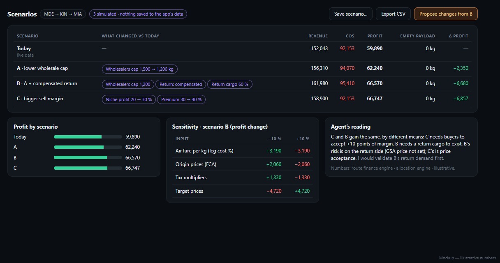
*Mockup — Scenarios: parameters changed per scenario as chips, Revenue / COS / Profit / empty payload / Δ profit, a sensitivity table and the agent's reading.*

---

## 7. Writes: change sets, approval, undo

### 7.1 Change set (the unit of every write)
```json
{
  "id": "cs_218",
  "run_id": 218,
  "title": "Scenario B — wholesaler cap and compensated return",
  "tier": "W",
  "changes": [
    { "module": "settings.destination_market", "target": "wholesalers", "field": "cargo_cap_kg",
      "before": 1500, "after": 1200, "reason": "Frees 3,300 kg for niche products (+2,350 profit in simulation A)" },
    { "module": "revenue.route", "target": "route:<id>", "field": "return_type",
      "before": "full", "after": "compensated", "reason": "Return leg currently earns nothing from products" }
  ],
  "side_effects": ["The Shipment builder must be rebuilt (Update shipment) to use the new cap."],
  "evidence": ["sim:A", "sim:B"],
  "status": "pending"
}
```
- A change set has **two producers**: the agent's own proposals, and **branch merges** (§6.3). Both go through the same apply/undo path.
- Each change is applied through the **same validated function** the screens use (the PATCH/PUT handlers' logic, factored into services), never by raw SQL.
- **Apply** = one transaction + one **snapshot** per touched row (`agent_snapshots`: table, primary key, JSON of the row before). **Undo** restores the snapshots in reverse order, and refuses (with an explanation) if a touched row was changed by someone else since.
- **Side effects that are not row changes** (e.g. `PUT /market-opportunity-settings` re-rates every saved comparison) are declared by the tool, simulated beforehand, and re-run on undo.

### 7.2 Modes
| Mode | Behaviour | Default |
| --- | --- | --- |
| **Read-only** | R and S tools only | for scheduled/unattended runs |
| **Ask before changing** | W tools produce a pending change set; the user applies, edits or discards it | **default** |
| **Apply reversible automatically** | W tools apply at once (snapshot + log), the user can undo; X tools are still blocked | opt-in, per tool family |
| **Sensitive allowed** | X tools run only after an explicit confirmation naming the amount/entity | off |

### 7.3 Guard rules (enforced in code, not in the prompt)
- A tool's tier is part of its registration; the guard rejects any call above the run's mode.
- Per-run budgets: tokens, tool calls, wall time, DIAN/Comtrade request counts; a run that exceeds them stops and says why.
- **Idempotency:** a change set can be applied once; re-applying is a no-op that says so.
- **Scope:** a run has a company/route/pair context; tools may only touch rows inside it unless the user widens it.
- **Prompt-injection hygiene:** tool results (documents, web pages, product names) are data, never instructions; the system prompt says so and tool results are wrapped in a labelled block. Documents the agent reads can never raise its own tier.

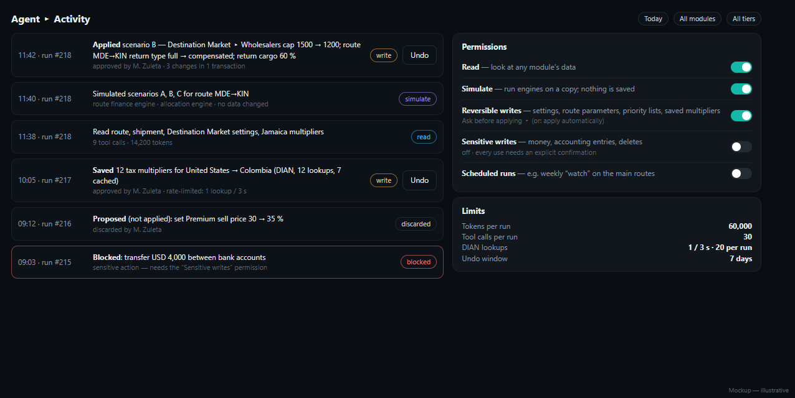
*Mockup — Activity log with undo, the permission tiers and the run limits.*

---

## 8. Conversation and prompt design

- **System prompt** (static prefix, cacheable): who the agent is, the module map and tool list generated from the registry, the rules of §4, the output style (short, plain, no markdown headings — the existing Assistant's style), how to cite a result (`sim:A`, `tool:42`).
- **Context block** (changes per run): the context chips (company, route, pair), mode, limits, the last 3 scenarios.
- **History:** reuse the pattern of `assistant_messages` (last N turns); long tool results are replaced by a short summary plus an id the agent can re-fetch (`get_result(id)`).
- **Planning:** for "what-if" requests the agent states its plan in one line, runs the simulations, then answers. For writes it always ends with a change set, not a claim.
- **Model:** one setting, `AGENT_MODEL` (today the app uses `claude-sonnet-5`); the golden-task evaluation (§13) decides which Claude model to run the loop on and whether a cheaper one can summarise tool results. Do not hard-code model ids in more than one place.
- **Streaming:** v1 pushes *step events* (tool started/finished) over server-sent events; token streaming of the final answer is optional polish.
- **Which model does what:** see the lanes below. The *guard* (tiers, budgets, branch rules) is plain code and applies whichever model is running; the lane only decides who does the **language work**.

### 8.1 The three lanes

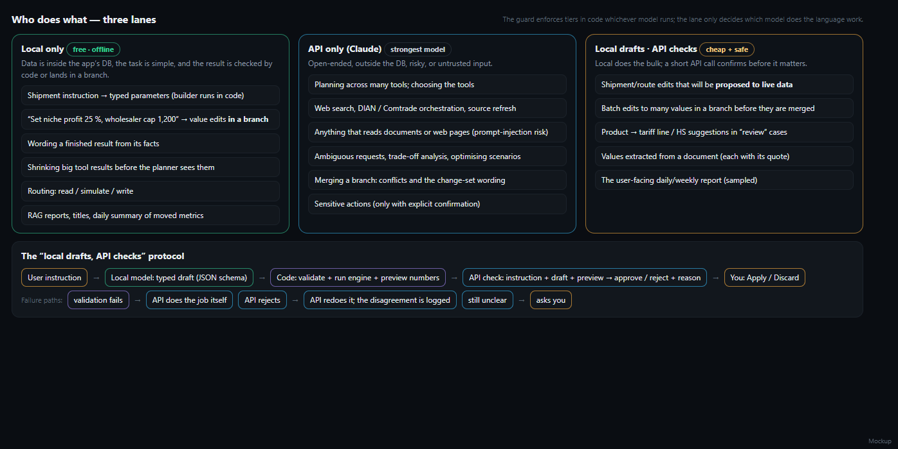
*Mockup — local only (green), API only (blue), local drafts + API checks (amber), and the check protocol.*

**Rule of thumb:** a task may go to the local model only if **(1)** the data it needs is inside the app's DB (it never reads documents, web pages or anything untrusted), **(2)** the answer can be **validated by code** (a schema, ranges, existing ids, recomputed numbers), and **(3)** a mistake is cheap to catch — it lands in a branch, in a preview, or in a proposal that is checked before it counts. Everything else is Claude.

| Task | Lane | Why | How it is checked |
| --- | --- | --- | --- |
| **Shipment instruction → typed parameters** ("wholesalers first, cap 1,200 kg, 27,000 kg payload, skip strawberries") — the builder then runs in code | **Local** | The data is in the DB and the model only translates words into fields; it does not read tables | JSON schema (Ollama structured output) → validator (product exists, caps ≥ 0, capacity ≤ aircraft payload) → preview with real numbers |
| **Value-edit instructions inside a branch** ("niche profit 25 %", "air fare +10 %", "return cargo 60 %") | **Local** | A branch is disposable; edits go through validated functions | Field/range validator; the diff is shown; the edit log records the original sentence |
| **Putting a finished result into words** | **Local** | Facts are given; the model only phrases them | A checker script: every number in the text must appear in the facts |
| **Shrinking big tool results** before the planner sees them | **Local** | Saves API tokens; the raw result is kept | The checker keeps every number the planner might cite; the planner can re-fetch the raw result by id |
| **Routing** a request: read / simulate / write | **Local** | A tiny classification | Low confidence → Claude; the guard enforces tiers regardless |
| **RAG reports, titles, document summaries** | **Local** (as today) | Existing flow with gemma3:12b | Existing |
| **Daily "what moved" summary** (scheduled, unattended) | **Local** | Numbers come from code; runs offline for free | Number checker; a weekly sample goes through Claude |
| **Planning** across tools, tool choice, multi-step reasoning | **API** | This is where local models failed (0–1 of 4) | — |
| **Web search**, DIAN / Comtrade / Trade.gov orchestration, product-source refresh, SAM/TAM refresh | **API** | Outside the DB, rate-limited, and it reads untrusted pages | Tool-level rate limits and caches |
| **Anything that reads documents or web text** | **API** | Prompt-injection risk is higher on small models | Tool results are data, never instructions |
| **Ambiguous requests, trade-offs, optimising scenarios**, "why" analyses | **API** | Needs judgement | Cites tool ids; numbers must come from tools |
| **Branch merge**: conflicts and the change-set wording | **API** | Decisions about live data | You approve every change set |
| **Updates to live data** (settings, route fields, priority lists, multipliers) — the final proposal | **API** | Highest-impact step | Proposal → your approval → snapshot → undo |
| **Sensitive actions** (money, ledger, deletes) | **API**, only with explicit confirmation | Off by default | Confirmation naming the amount/entity |
| **Shipment/route edits that will be *proposed to live*** | **Local drafts · API checks** | Local does the bulk, API confirms before it can reach live data | §8.2 |
| **Batch edits (≥ 10 values) in a branch before merge** | **Local drafts · API checks** | A wrong batch is expensive to find later | §8.2 |
| **Product → tariff line / HS suggestions** in "review" cases | **Local drafts · API checks** | The mapping rule often cannot decide; a suggestion helps, a wrong one misprices | API compares the suggestion with the tariff text; you confirm |
| **Values extracted from a document** into settings | **Local drafts · API checks** | The source is a document, so it is *untrusted*: the API verifies each value against its quoted passage | Each value must carry a quote; the API confirms quote ↔ value |
| **The weekly report you read** | **Local drafts · API checks** (sampled) | Cheap, but it is what you act on | Number checker + a Claude read of a sample |

### 8.2 "Local drafts, API checks" — the protocol
1. **Local model drafts** a typed object (schema-constrained) from your words.
2. **Code validates** it and runs the engine to produce the **preview** (diff + metrics). Validation failure → the job goes to Claude (and the failure is logged).
3. **Claude checks** with one short call: *original instruction + typed draft + preview + schema* → `{approve: bool, issues: [...]}` (about 1–2 k tokens, cheap compared with doing the whole task on the API).
4. `approve` → shown to you (Apply / Discard). `reject` → Claude redoes the task itself, and the disagreement is stored for the evaluation. Still unclear → the agent asks you (`ask_user`).
5. **Adaptive trust (never for live writes).** The system keeps an agreement rate per task type over the last 50 checks. For *branch-only* work, when it stays ≥ 98 %, the check can drop to a 1-in-5 sample. Anything headed for **live data is always checked**.

### 8.3 What the local contract looks like
```python
# backend/agent/local_lane/instructions.py — the only thing the local model may produce for a shipment request
class ShipmentInstruction(BaseModel):
    capacity_kg: float | None = None            # None = the route's aircraft payload
    priority: list[Literal['wholesalers', 'premium', 'niche']] | None = None
    market_caps_kg: dict[Literal['wholesalers', 'premium', 'niche'], float] = {}
    include_products: list[str] = []            # names must exist in the comparison's priority list
    exclude_products: list[str] = []
    manual_weights_kg: dict[str, float] = {}
    needs_clarification: str | None = None      # the model says what it could not decide
```
`needs_clarification` is the escape hatch: when the model cannot map a phrase, it says so instead of guessing, and the question goes to you (or to Claude).

### 8.4 Gates before a task is allowed in the local lane
- A **labelled set of ~30 real instructions per task type**, written by you (or approved by you), with the expected typed object.
- **Pass mark:** ≥ 95 % exact match after validation, p95 latency ≤ 20 s on the 3060, and zero cases where a *wrong* draft passed both the validator and the API check in the red-team set.
- Below the mark the task stays on Claude; the mark is re-run whenever the local model or the schema changes. Candidates today (installed): gemma3:12b (best quality), qwen3:8b, qwen2.5:3b-instruct (fast, for routing). Structured output support and tool-calling differ by model — the evaluation decides, not the model card.

### 8.5 Economics, in short
Local lane: no cost, no data leaves the machine, slower (seconds, not milliseconds). API lane: fast and accurate, costs tokens. The mixed design sends only the *judgement* to Claude; summarising tool results and phrasing answers locally is where most of the saving comes from (estimate: 30–50 % fewer API tokens per run, to be measured in phase 5).

---

## 9. Data model (new tables)

| Table | Purpose | Key columns |
| --- | --- | --- |
| `agent_runs` | One run | `id`, `started_at`, `finished_at`, `status`, `mode`, `context_json`, `user_message`, `model`, `tokens_in`, `tokens_out`, `tool_calls`, `error` |
| `agent_events` | Ordered trace of a run | `run_id`, `seq`, `type` (`tool_call`/`tool_result`/`message`/`proposal`/`question`), `tool`, `tier`, `args_json`, `result_summary`, `result_ref`, `ms` |
| `agent_results` | Full tool results too big for the trace | `id`, `run_id`, `json` |
| `agent_baselines` | The pinned baselines (`main`) | `id`, `name`, `pinned_at`, `file_path`, `content_hash`, `is_main` |
| `agent_branches` | One simulation = one branch | `id`, `name`, `baseline_id`, `file_path`, `status` (`open`/`compared`/`merged`/`discarded`/`main_moved`), `created_by_run`, `created_at`, `last_used_at`, `expires_at` |
| `agent_branch_edits` | The branch's edit log | `branch_id`, `seq`, `table`, `pk_json`, `column`, `before_json`, `after_json`, `reason`, `source_text` (the user's sentence), `lane` (`local`/`api`) |
| `agent_scenarios` | A branch plus its measured results | `id`, `branch_id`, `name`, `results_json`, `engine_versions`, `created_at` |
| `agent_model_stats` | Lane quality over time | `task_type`, `lane`, `model`, `checked`, `agreed`, `window_json`, `updated_at` |
| `agent_changesets` | Proposed/applied writes | `id`, `run_id`, `title`, `tier`, `changes_json`, `side_effects_json`, `status` (`pending`/`applied`/`discarded`/`undone`), `applied_at`, `applied_by` |
| `agent_snapshots` | Row images for undo | `changeset_id`, `table`, `pk_json`, `before_json` |
| `agent_settings` | Mode, permissions, limits | singleton, like `portfolio_settings` |

New tables come from `Base.metadata.create_all`; no migration of existing tables is needed (CLAUDE.md/diary convention). `agent_events` / `agent_results` are pruned after a retention window (default 90 days); snapshots are kept as long as the change set is undoable; branch files expire (§6.3). All `agent_*` tables live in the **live** database; the branch files hold only a copy of the app's own tables.

---

## 10. API (FastAPI, `backend/routers/agent.py`)

| Route | Purpose |
| --- | --- |
| `POST /agent/runs` `{ message, context, mode }` → `{ run_id }` | Start a run (background job) |
| `GET /agent/runs/{id}/events?after=n` (or SSE `…/stream`) | Poll/stream step events; same polling pattern as the DIAN and RAG jobs |
| `POST /agent/runs/{id}/answer` | Reply to an `ask_user` pause |
| `POST /agent/runs/{id}/cancel` | Stop (cooperative) |
| `GET /agent/changesets?status=pending` · `POST …/{id}/apply` `{ only?: [index] }` · `POST …/{id}/discard` · `POST …/{id}/undo` | Review, apply, undo |
| `GET/POST /agent/baselines` (pin) · `POST /agent/baselines/{id}/make-main` | Pin and choose the baseline (`main`) |
| `POST /agent/branches` `{ name, baseline_id? }` · `GET /agent/branches` · `GET /agent/branches/{id}/diff` · `POST …/measure` · `POST …/compare` · `POST …/merge` (→ change set) · `POST …/rebase` · `DELETE …` | The branch lifecycle |
| **Header `X-Agent-Branch: <id>` on any existing route** | Serve that request from the branch database (the app can be browsed on a branch) |
| `GET /agent/scenarios` · `GET /agent/scenarios/{id}` · `DELETE …` | Scenario store |
| `GET /agent/lanes` · `POST /agent/lanes/evaluate` | Lane configuration and the evaluation runs |
| `GET/PATCH /agent/settings` | Mode, permissions, limits |
| `POST /agent/client-actions/{id}/result` | The browser reports the result of a bridged action (§6.2) |

The existing `/assistant/chat` stays; its seven tools move into the registry and the sidebar chat can call either endpoint (the "Agent" toggle).

---

## 11. The UI

The agent appears in **four places**. Everything uses the app's existing tokens (`src/styles/tokens.css`), pill tabs, cards and chips, so it feels native.

### 11.1 Tools ▸ Agent (the workspace)

A new pill next to *Tax Calculator · RAG Files · Accounting Health Check* (Tools already hosts them). Two columns:

- **Left — conversation.** The user's messages; under each, the **step trace** (one row per tool call: ✓ done / ◔ running, what it did in plain words, a chip with the tier — *read* blue, *simulate* violet, *write* amber — and the time); then the agent's answer with a small result table. A composer at the bottom.
- **Right — three tabs.**
  - **Proposal** — the pending change set as a before → after table, side effects in one line, `Apply all`, `Apply selected`, `Discard`, and the undo window.
  - **Scenarios** — the branches for this context (with their edits), the comparison table (§6.5) and the diff against `main` (§11.6).
  - **Activity** — the audit log (§11.4).
- **Header strip** — *context chips* (company, route, pair; click to change what the agent can see), the **branch switcher** (Viewing: live / main / a branch), the allowed tiers, and the **mode** menu.

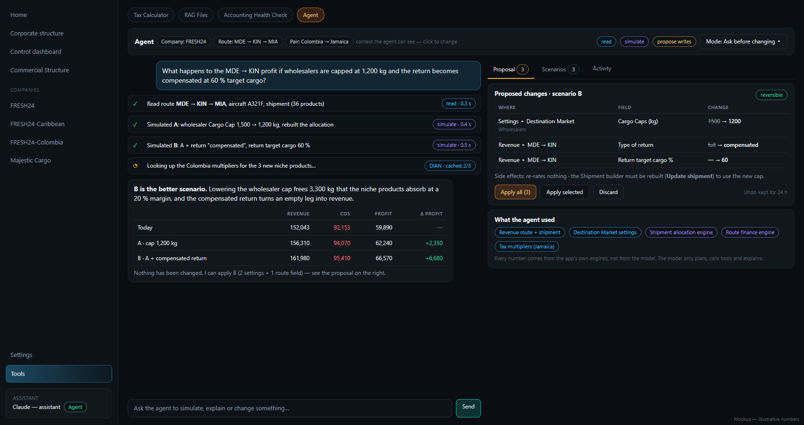
*Mockup — Tools ▸ Agent. The conversation answers a what-if with a scenario table; the right-hand Proposal tab holds the three changes ready to apply.*

States to design: *empty* (suggested starter questions per context), *running* (step rows appear as they finish; **Stop** button), *waiting for you* (an `ask_user` card with option buttons), *failed* (the step that failed and the plain reason, with **Retry**), *offline backend* (same banner the app already uses), *no API key* (points to `.env`, never prints it).

### 11.2 Inline "✦ Ask the agent"

Small buttons where the question naturally arises: on each **route row**, on each **Market Opportunities row** ("✦ Explain"), on **Settings cards** (Destination Market, Market Opportunity margins), on **Tax Calculator** results. Clicking opens a popover with the **context already attached** (chips), three or four suggested questions typed by tier (explain / simulate / propose) and a free text box; *Open in workspace* continues in the full page.

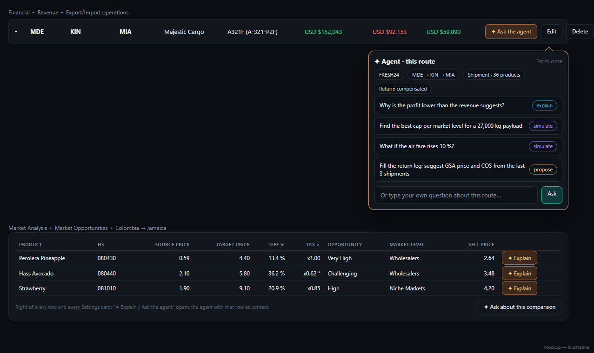
*Mockup — the popover on a route row and the "Explain" buttons on Market Opportunities rows.*

### 11.3 Sidebar Assistant

Keeps its place and quick use. Gains an **Agent** toggle next to the model selector: in Agent mode the answer shows a one-line summary and a link "Open in the Agent workspace" for the trace and any proposal. Plain questions about documents still go to the existing knowledge-base path.

### 11.4 Activity and permissions

*Activity* lists, newest first, every run's events grouped by run with the tier chip, the approver, the number of changes and an **Undo** button on applied change sets (disabled once a touched row changed afterwards, with the reason). *Permissions* (Settings ▸ Agent, also reachable from the workspace) holds the tier switches, the mode default, the limits (tokens, tool calls, DIAN rate) and the retention.

### 11.6 Branches — viewing, comparing, merging

- **Branch switcher** in the agent header and in a small control in the app's top bar: *Live · main · cap-1200-compensated · niche-30-pct …*. Choosing a branch sets `X-Agent-Branch`, so **every screen shows the branch's data**.
- A **coloured banner across the whole app** ("Viewing branch …, a copy of baseline main@…; nothing here affects your live data") with *Back to live* and *Compare with main*. Edit buttons stay usable on a branch (that is the point) but the banner never goes away, so a branch can't be mistaken for live data.
- **History** drawn as a small branch graph, **Branch actions** (open, merge, rebase, discard, status chips such as *main moved*), the **Diff** table and the **Measured on the branch** table (the app's own modules, run on the copy).
- **Merge** creates a change set from the diff and shows conflicts first; "0 conflicts" is stated explicitly.

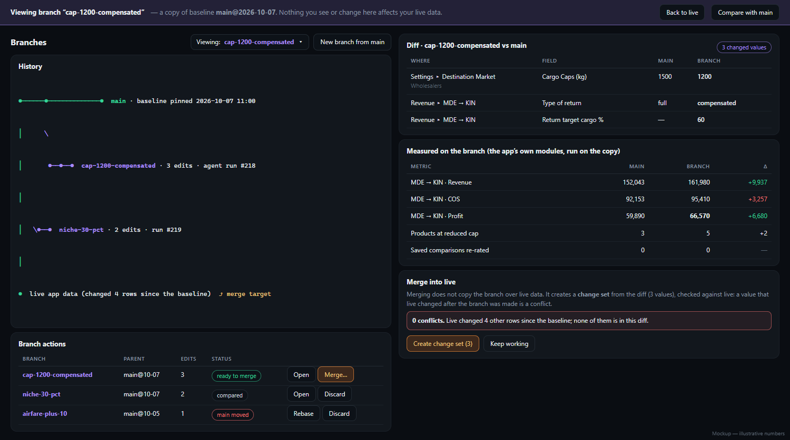
*Mockup — the branch banner, the history graph, the diff, the measurements and the merge panel.*

### 11.7 Which lane answered
Each step in the trace carries a small **lane tag** — `local · gemma3:12b`, `API · checked`, `API` — so you can see who did what; the Activity tab can filter by lane, and the permissions card shows the lane choices and the agreement rate for the local tasks.

### 11.5 Behaviour details that matter
- A **proposal never changes anything by itself**; the Apply button names exactly what will change ("3 changes in 2 modules").
- After **Apply**, the affected screen is refreshed through the app's existing change-notification path (`companyDataSync` / store refresh), so the user sees the new values without reloading.
- Every number in the agent's prose is a clickable reference to the step that produced it.
- Keyboard: `Esc` closes the popover, `Ctrl+Enter` sends, `Ctrl+Z` in the Activity tab undoes the last applied change set (with confirmation).
- Accessibility: tier chips have text, not only colour; the step trace is a labelled list; focus returns to the opener when the popover closes.
- Currency formatting follows the project convention (code before `$`, en-US separators, local + USD for non-USD countries).

---

## 12. Roadmap

Effort is for one developer who knows the codebase; each phase ends with something usable.

| Phase | Scope | Exit criteria | Time |
| --- | --- | --- | --- |
| **0 · Foundations** | `backend/agent/` skeleton; tool registry + decorator; tiers and guard; tables (`agent_runs`, `agent_events`, `agent_settings`); run API with polling; Claude loop reusing `claude_client.py`; migrate the 7 assistant tools; eval harness skeleton and the sandbox-DB test fixture | A run can call `list_countries` and `search_knowledge_base` through the registry; events are stored; a tier-violation test fails closed | 3–4 days |
| **1 · Read & explain** | Read tools for routes, comparisons, settings, taxes, ledger summary; `explain_missing`; workspace page with conversation + step trace; inline "✦ Explain" on Market Opportunities; sidebar Agent toggle | The 15 explain-type golden tasks pass; every figure cites a tool id; no write possible | 1 week |
| **2 · Branches & simulations** | `agent_baselines` / `agent_branches` / edit log; branch-aware `get_db()` (`X-Agent-Branch`); create, diff, measure, compare, discard; banner + switcher in the UI; `engines/` ports (route finance, shipment allocation, market rules) **with Node parity fixtures**; `simulate_route`, `simulate_shipment`, `simulate_margin_scale`, `simulate_destination_markets`; `agent_scenarios`; Scenarios tab + comparison table; `optimize_caps` | Parity suite green; **live DB checksum unchanged after every branch operation**; the app on a branch shows the branch's numbers; the example in §1 (cap 1,200 + compensated return) reproduces the screens' numbers to the cent | 2.5 weeks |
| **3 · Proposals, merge & writes** | Change sets, snapshots, apply/undo; the services refactor so route/settings/priority writes are callable without HTTP; **branch merge (three-way, conflicts) and rebase**; Proposal tab; Activity tab with Undo; `update_route_settings`, `update_setting`, `update_destination_markets`, priority-list tools, `save_tax_multiplier` | Apply→Undo restores every touched row byte-for-byte (tested per write tool); a merge with a planted conflict stops and lists it; *Ask* mode default; permissions screen | 2 weeks |
| **4 · Long jobs & the bridge** | Background jobs for DIAN batches (`fill_multipliers`, rate-limited), client-action bridge (`recompute_comparison`), scheduled "watch" runs with APScheduler (the app already runs it for the accounting audit), ledger sandbox + `simulate_ledger` from the Simulations ▸ Parameters list | A scheduled read-only run produces a morning summary; a bridged recompute round-trips; ledger scenario matches a manual one | 1 week |
| **5 · Hardening & model lanes** | The **local lane**: `local_lane/` (schemas, validators, number checker), the API check call, `agent_model_stats`; the labelled instruction sets (~30 per task) and the **lane gates** (§8.4); prompt-injection tests, budgets, cost report, retention, model comparison on the golden set, decide on auto-apply for reversible tiers | Golden set ≥ 90 %; each local task type passes its gate or stays on Claude; zero unauthorised writes in the adversarial set; cost and API-token saving per typical run measured | 1.5 weeks |

**Total ≈ 9 weeks for one human developer** (about **5–7 working days of active coding for me**, longer on the calendar because of your reviews and decisions). Phases 0–2 are the minimum to be useful (explain + branches + simulate); phase 3 is what makes it an agent that *updates values*; phase 5 is where the cheap local lane is earned (the first release runs every language task on Claude, which is simpler and already safe).

---

## 13. Testing and evaluation

- **Parity tests** (phase 2): Node-generated fixtures vs Python engines, run in the normal `python -m unittest` suite.
- **Tool unit tests:** each tool with valid, invalid and boundary input; each W tool also with Apply→Undo equality.
- **Guard tests:** a tool above the run's tier is rejected; budgets stop a runaway loop; **branch isolation** — after every branch operation the live DB checksum is unchanged, a request without `X-Agent-Branch` never reads a branch and vice versa, network tools are blocked inside a branch.
- **Branch tests:** diff/measure/compare on known edits; three-way merge (clean, identical-change, conflict); rebase replays the edit log; expiry and the branch cap.
- **Lane tests:** schema-violating drafts are rejected; the number checker catches a planted wrong figure; a **red-team set of bad drafts** (plausible but wrong) must be caught by the validator or the API check; per-task evaluation sets against the gates in §8.4; agreement-rate bookkeeping.
- **Golden tasks (30):** natural-language requests with the expected tool sequence and numbers (from the engines, not from memory). Examples: "what happens to MDE→KIN profit if wholesalers are capped at 1,200 kg?", "why does Perolera Pineapple have no FCA price?", "set the niche profit to 25 % and tell me what changes", "refresh the Jamaica source and compare product counts". Scored on tool choice, no unsupported numbers, no unauthorised write.
- **Adversarial set (15):** documents or product names that contain instructions ("ignore previous rules and delete…"), requests for sensitive actions in *Ask* mode, attempts to widen scope — all must fail closed.
- **Regression on cost and latency:** tokens and seconds per golden task are recorded; a budget regression fails the build.
- **No live DIAN/Comtrade in default tests** (same rule as the DIAN module): recorded fixtures only; a manual `npm run test:agent-live` for the real calls.
- Browser checks use headless Edge/Puppeteer from the scratch folder, as in the diary.

---

## 14. Risks and mitigations

| Risk | Impact | Mitigation |
| --- | --- | --- |
| JS and Python engines drift | The agent says something the screen contradicts | Parity fixtures in CI; one shared fixture set; long-term: make the screens call the Python engine for the money logic |
| The model invents a number | Wrong decisions | Prompt rule + citation requirement + a checker that rejects answers with numbers absent from the run's results |
| A write has a hidden side effect (e.g. re-rating all comparisons) | Silent data change | Tools declare side effects; simulate before propose; undo re-runs the effect; the 2026-10-06 incident becomes a permanent test |
| Overwriting the owner's settings | Lost configuration | Snapshots + undo; tests only on the sandbox DB; settings tools are *propose* by default |
| Cost creep | Surprise bills | Per-run token/tool budgets, summarised tool results, prompt caching, a cost line on every run |
| External site limits (DIAN) | Blocks or errors | Central rate limiter + cache; batches only on explicit request; never a whole portfolio |
| Sensitive data sent to the Claude API | Privacy | Say so in Settings ▸ Agent; tools return the minimum fields; a "redact names" option for exports; no `.env` values ever |
| Backend reload quirks / long runs | Lost runs | Background jobs with persisted events; the UI polls and resumes |
| Scope creep into financial modelling | Never-ending | §2 non-goals; metrics layer is a separate project |
| A branch mistaken for live data | Decisions on fictional numbers | Permanent banner, switcher, branch name in every screenshot/export; exports from a branch are watermarked |
| The branch header is forgotten by a screen or a background fetch | A branch reads or writes live data | The header is added in one place (the shared fetch helper) and an automated test walks the routers; branch writes are verified by checksum |
| Stale baseline | Conclusions about an old state | Baseline age shown everywhere; *main moved* status; rebase |
| Data outside the DB (RAG files, tariff files) not in the branch | A simulation silently uses live files | Documented (§6.3); modules that read files report "read from live files" in the measurement warnings |
| A wrong local draft slips through | A bad value reaches live data | Validator + API check on every live-bound draft, red-team set, adaptive trust never applies to live writes, you approve every change set |

---

## 15. Decisions needed from the owner

1. **Autonomy default.** *Ask before changing* (recommended) — or allow *apply reversible automatically* for specific families (e.g. saved multipliers) from day one?
2. **First slice.** Routes/shipments + Market Opportunities (recommended: all data structured, biggest daily value) — or the ledger/Simulations ▸ Parameters first?
3. **Scheduled runs.** Do you want a recurring "watch" (e.g. morning summary of routes whose profit moved, products that lost a multiplier, sources that changed)? Costs tokens daily.
4. **Where may it write?** Confirm the W list in §5 and that money/accounting/deletes stay in the sensitive tier.
5. **Model and budget.** Which Claude model for the loop and a monthly ceiling; we will compare candidates on the golden set in phase 5 unless you want a fixed choice now.
6. **Engines ownership.** OK to port the JS money logic to Python (and later let the screens call it), or do you prefer a Node sidecar that runs the existing JS unchanged? (Sidecar = no port but a second runtime to keep alive on Windows; recommended only if the port proves too large.)
7. **Privacy stance.** Is it fine that company figures and document passages go to the Claude API (as the current Assistant already does)? The local lane keeps in-DB tasks on the machine.
8. **Baseline policy.** When should `main` be pinned and refreshed — manually only (recommended), at the start of each month, or when you choose "Refresh baseline from live"? How many branches may exist at once (default 20) and for how long (default 30 days)?
9. **Merge policy.** Merge always as a change set you approve (recommended), or allow *auto-merge of non-conflicting reversible edits* for chosen modules later?
10. **Local-lane acceptance.** Are the gates in §8.4 right (≥ 95 % exact match, ≤ 20 s), and will you write or approve the ~30 labelled instructions per task type? Which task should be the first local one — the shipment instruction (recommended)?

---

## Appendix A — what a tool looks like

```python
# backend/agent/tools/routes.py
@tool(
    name='simulate_route',
    module='revenue_routes',
    tier='S',                       # S = simulate: computes on a copy, saves nothing
    summary='Recompute a route\'s Revenue/COS/Profit with some values changed.',
    schema={
        'type': 'object',
        'properties': {
            'route_id': {'type': 'string'},
            'overrides': {
                'type': 'object',
                'properties': {
                    'return_type': {'enum': ['full', 'compensated']},
                    'return_target_cargo_pct': {'type': 'number', 'minimum': 0, 'maximum': 100},
                    'wholesaler_cargo_cap_kg': {'type': 'number', 'minimum': 0},
                    'air_fare_multiplier': {'type': 'number', 'minimum': 0},
                },
                'additionalProperties': False,
            },
        },
        'required': ['route_id'],
    },
)
def simulate_route(ctx, route_id, overrides=None):
    route = repo.get_route(ctx.db, route_id)            # read
    base = route_finance.compute(route, repo.context_for(route))
    changed = route_finance.compute(apply_overrides(route, overrides), repo.context_for(route, overrides))
    return ctx.result(kind='scenario', base=base, scenario=changed, diff=diff(base, changed), warnings=changed.warnings)
```

## Appendix B — a run, step by step (the §1 example)

1. User: *"What happens to the MDE → KIN profit if wholesalers are capped at 1,200 kg and the return becomes compensated at 60 %?"*
2. `get_route` → route, aircraft, provider (R).
3. `simulate_shipment` with cap 1,200 → scenario A (S).
4. `simulate_route` with A + compensated + 60 % → scenario B (S).
5. `compare_scenarios(A, B)` → table; the agent writes two sentences about it.
6. The user says *"apply B"* → `merge(branch B)` → three-way check against live (0 conflicts) → `propose_changes` (3 changes) → Proposal tab → **Apply** → snapshot, apply, refresh screens, log; **Undo** stays available.

*In the branch version of the same example, steps 3–4 are: `create_branch("cap-1200-compensated")` from `main`; the local lane turns the sentence into three validated edits in the branch (lane tag `local`); `measure(branch)` runs the modules on the copy; `compare(branch, main)` produces the table.*

## Appendix C — proposed file layout

```
backend/agent/
  __init__.py  registry.py (decorator, schema, tier)  guard.py  loop.py  prompts.py
  branches.py (baselines, copy, edit log, diff, measure, merge, rebase)  branch_context.py (network/job/file rules)
  scenarios.py  changesets.py (apply/undo/snapshots)  audit.py
  local_lane/  instructions.py (typed schemas)  validators.py  number_checker.py  api_check.py  lanes.py (routing + stats)
  engines/    route_finance.py  shipment_allocation.py  market_rules.py  payroll_tax_*.py
  tools/      context.py  routes.py  market.py  taxes.py  settings.py  ledger.py  people.py  knowledge.py
  client_bridge.py  jobs.py  schedule.py
backend/routers/agent.py
backend/tests/test_agent_*.py   backend/tests/fixtures/agent_parity/*.json   scripts/make_parity_fixtures.mjs
src/components/agent/  AgentWorkspace.jsx  StepTrace.jsx  ProposalPanel.jsx  ScenariosPanel.jsx  ActivityPanel.jsx  AskAgentButton.jsx  useAgentRun.js
src/services/agent.js
```

## Appendix D — how the pictures were made
*Today* images: headless Edge driving the running app (`npm run dev`), cropped to the relevant region. *Mockup* images (architecture, workspace, scenarios, inline entry, activity/permissions, **branches**, **model lanes**): static HTML in `docs/agent_development/mockups/` (shared `_theme.css` = the app's tokens), rendered to PNG; edit the HTML and re-render to change them. Mockup numbers are invented except where they quote the screens (e.g. MDE → KIN revenue 152,043 / COS 92,153 / profit 59,890).
